# lastmile qa.

Persistent AI test users for applications in development. Connect a GitHub repository, branch and audience intent, or an existing local development app. LastMile reads relevant source, observes the UI, generates a test team and checks what actually persists. On later releases, it retains the team's identities, history and requirement-backed expectations.

## Run locally

Use Node 22+ and pnpm 10.33.0.

1. `pnpm install`
2. `pnpm exec playwright install chromium`
3. Copy `.env.example` to `.env` only if it does not exist. Add `OPENAI_API_KEY`. `OPENAI_MODEL=gpt-5.4` is the model used for the development-project acceptance checks. Real generation and execution make paid model calls.
4. `pnpm build` then `pnpm start`. Use `pnpm dev` while editing LastMile itself.

Open [LastMile](http://127.0.0.1:3000). The runner defaults to port 4000. Stop an existing stack before starting another; environment changes require a restart.

## Main flow

1. **New project → GitHub:** provide the repository URL, branch and a plain-language description of the users and work to test. Add `GITHUB_PAT` to the runner’s `.env` once. Vendure setup automatically clones, installs, builds, starts and provisions native development accounts. Other trusted repositories use custom install/build/start commands. **Local development** remains available for an existing repository and running app.
2. **Run test team:** the model generates tasks from source and observed UI. Separate browsers use the supplied accounts. Independent checks reopen pages and compare saved values or preserved state. Expand evidence to see expected versus observed results.
3. **Sync & test:** fetch the selected GitHub branch and rebuild while preserving native development data and tester profiles. Original checks remain frozen. A merged verified fix reuses coverage; other source changes can add journeys. Local projects use **Test changes** after rebuilding their app.
4. **Automatic fix and verification:** when a run has a conclusive failure and a passing control, the runner reproduces the behavior privately, proposes a source patch, and replays the frozen cases without another click. Private verification needs the application build/start commands and any supported database snapshot configured at connection time. Replay makes zero model calls.
5. **Review the result:** inspect expected versus observed values, the patch, and its verification outcome. Incomplete evidence or an unsupported setup is reported explicitly. For GitHub projects, independently verified patches automatically become a pull request against the tested revision. Merge on GitHub manually, then use Sync & test. No automatic merge or deployment. Local-project patches remain in private copies.

This local runner executes trusted repositories under your operating-system account; it is not a security sandbox for untrusted repositories. Credentials and browser session state stay server-side. Account-bearing sessions suppress screenshots; redacted steps and check results remain available. Source-derived expectations are labeled separately from requirements. Synthetic testers provide software test coverage, not measured human behavior or proof of accessibility compliance.

## Substantial application benchmark

The local benchmark uses native Vendure v3.5.0, pinned to `534e6003534f74761e82de1b8c6061cba89945d1`. Core plus React dashboard comprise 134,726 physical source lines across 1,211 files, excluding tests, dependencies and generated output. Indexing this repository does not mean every workflow is tested.

See [Vendure setup](integrations/vendure/README.md). Setup is `node scripts/setup-vendure.mjs`; the native dashboard runs at [port 9005](http://127.0.0.1:9005/dashboard/). It uses ordinary staff accounts and application pages, with no LastMile workflow adapter or test endpoint.

The main engine does not require a pre-registered scenario catalogue. Authentication methods, complex forms, unsupported infrastructure and incomplete observations can still leave coverage gaps. Private repair currently supports the configured local build/start commands and an optional SQLite snapshot; arbitrary remote databases are not automatically cloned. Source hashes identify indexed files, not the version currently served by a separate process.

## Architecture

```mermaid
flowchart LR
 A[Repository + dev URL + intent] --> B[Source index and browser observations]
 B --> C[Generated testers and frozen checks]
 C --> D[Persistent browser journeys]
 D --> E[Independent outcome verification]
 E --> F[Findings and passing controls]
 F --> G[Private coding patch]
 G --> H[Zero-model replay]
 H --> I[Verified fix PR]
 I --> J[Manual merge]
 J --> K[Sync and retest retained users]
```

The Next.js dashboard proxies authenticated requests to the runner. SQLite stores projects and durable jobs. Strands runs bounded browser actors. Authentication, precondition capture and browser journeys run serially against shared development data, matching repair replay and limiting memory use.

The workspace focuses on Projects, with Results, Team and History tabs. Connection setup opens from **New project**. Earlier collection/editor screens redirect to Projects; saved study, population, run and repair evidence links remain available. Their [historical compatibility instructions](docs/legacy-workflows.md) describe different setup and verification contracts. AWS hosting is a later deployment step; no AWS intelligence service is required.

## Use from a coding agent

The local MCP server lets Claude Code or Codex connect projects, inspect generated personas, launch explore/release runs and follow automatic private repair without dashboard clicks. It reuses the same authenticated runner and durable jobs. See [MCP setup, exact prompts and verification](docs/MCP.md). The app and runner must already be running.
